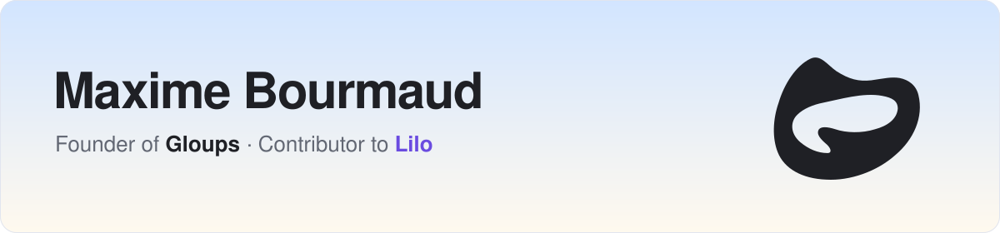
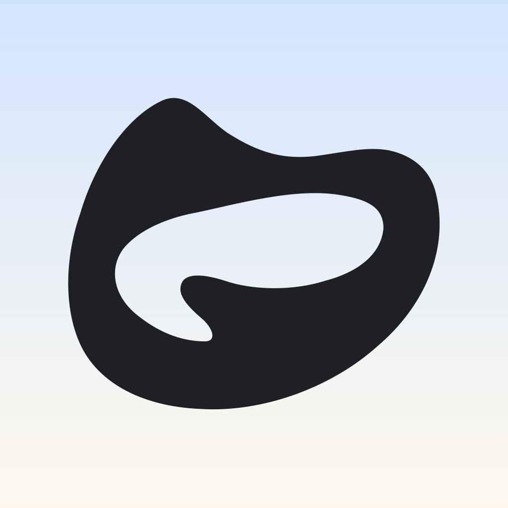
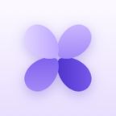

<picture>
  <source media="(prefers-color-scheme: dark)" srcset="assets/banner-dark.svg" />
  <source media="(prefers-color-scheme: light)" srcset="assets/banner-light.svg" />
  
</picture>

French software engineer based in Helsinki. I'm building a health companion, and tools that help AI agents work alongside people.

## What I'm working on

<table>
  <tr>
    <td width="50%" valign="top">
      <picture>
        <source media="(prefers-color-scheme: dark)" srcset="assets/gloups-dark.svg" />
        <source media="(prefers-color-scheme: light)" srcset="assets/gloups-light.svg" />
        
      </picture>
      <h3>Gloups</h3>
      <b>FOUNDER</b>
      
An AI health companion. Keep a food diary, log your water, and chat with Gloop, a coach that reads your diary and knows your goals.

      
<em>A little care, every day.</em>

      
<a href="https://gloups.app">gloups.app</a>

    </td>
    <td width="50%" valign="top">
      
      <h3>Lilo</h3>
      <b>CONTRIBUTOR</b>
      
A free, open-source Mac browser on WebKit, with Spaces, Chrome extensions, terminal tabs and a built-in MCP server. I'm its #2 contributor, working on Split View, rendering and localization.

      
<em>Your internet, in bloom.</em>

      
<a href="https://getlilo.app">getlilo.app</a>

    </td>
  </tr>
</table>

## Open source

Agent-ergonomic CLIs that give coding agents token-efficient access to the tools they need.

| Project | What it does | Stars |
| --- | --- | --- |
| **[notion-axi](https://github.com/maximebrmd/notion-axi)** | Search, read and write Notion pages and databases from an agent |  |
| **[supabase-axi](https://github.com/maximebrmd/supabase-axi)** | Wraps the Supabase CLI and Management API for coding agents |  |

## Tech stack

<table>
  <tr>
    <td><b>Languages</b></td>
    <td>   </td>
  </tr>
  <tr>
    <td><b>Web</b></td>
    <td>   </td>
  </tr>
  <tr>
    <td><b>Mobile</b></td>
    <td> </td>
  </tr>
  <tr>
    <td><b>Backend</b></td>
    <td>     </td>
  </tr>
  <tr>
    <td><b>Cloud &amp; ops</b></td>
    <td>   </td>
  </tr>
</table>

## Get in touch

[LinkedIn](https://linkedin.com/in/maximebrmd) is the best place to reach me.
