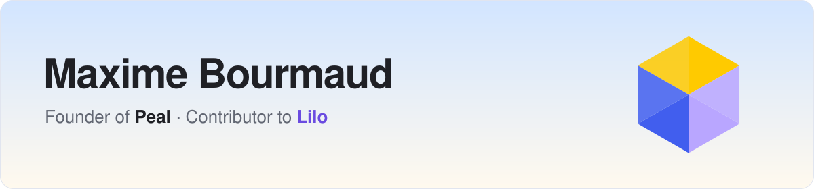
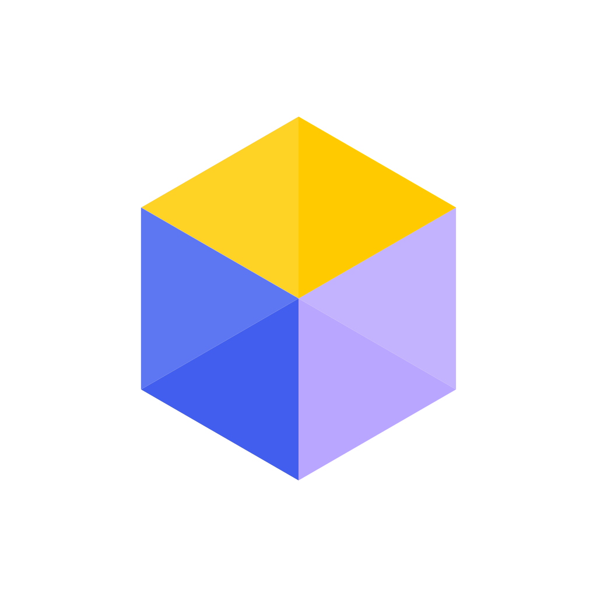
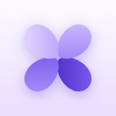

<picture>
  <source media="(prefers-color-scheme: dark)" srcset="assets/banner-dark.svg" />
  <source media="(prefers-color-scheme: light)" srcset="assets/banner-light.svg" />
  
</picture>

<p align="center">
  <picture>
    <source media="(prefers-color-scheme: dark)" srcset="https://readme-typing-svg.demolab.com?font=Inter&weight=500&size=20&duration=3200&pause=1400&center=true&vCenter=true&width=640&height=40&lines=Building+Peal%2C+a+social+media+scheduler+for+teams;Writing+CLIs+for+coding+agents;Contributing+to+Lilo%2C+a+Mac+browser+on+WebKit;Making+Gloups+on+the+side;%22Just+one+more+side+proje-%22&color=CBBDFF" />
    <source media="(prefers-color-scheme: light)" srcset="https://readme-typing-svg.demolab.com?font=Inter&weight=500&size=20&duration=3200&pause=1400&center=true&vCenter=true&width=640&height=40&lines=Building+Peal%2C+a+social+media+scheduler+for+teams;Writing+CLIs+for+coding+agents;Contributing+to+Lilo%2C+a+Mac+browser+on+WebKit;Making+Gloups+on+the+side;%22Just+one+more+side+proje-%22&color=6A4BE0" />
    
  </picture>
</p>

French engineer in Helsinki. I'm building Peal, a social media scheduler for teams. I also write CLIs so coding agents can use tools like Supabase without eating their whole context window. Gloups is my side project, which is a nice way of saying I have two products and one calendar.

```ts
const maxime = {
  based: "Helsinki, dark by 4pm in winter, great for shipping",
  building: ["Peal", "Gloups (side project, don't tell Peal)"],
  contributing: "Lilo, #2 on the leaderboard nobody asked for",
  workflow: "agents write the code, I write the vibes",
  skills: ["TypeScript", "Effect", "saying 'ship it' to an agent"],
  launching: "right after one more refactor",
};
```

## Things I'm building

<table>
  <tr>
    <td width="33%" valign="top">
      <picture>
        <source media="(prefers-color-scheme: dark)" srcset="assets/peal-dark.svg" />
        <source media="(prefers-color-scheme: light)" srcset="assets/peal-light.svg" />
        
      </picture>
      <h3>Peal</h3>
      <sub><b>FOUNDER</b></sub>
      <p>Schedule social posts with your team. It's fair source, so you can run it yourself if you'd rather. SDKs in eight languages, which is about seven more than anyone has asked for.</p>
      <p><a href="https://peal.social">peal.social</a></p>
    </td>
    <td width="33%" valign="top">
      <picture>
        <source media="(prefers-color-scheme: dark)" srcset="assets/gloups-dark.svg" />
        <source media="(prefers-color-scheme: light)" srcset="assets/gloups-light.svg" />
        
      </picture>
      <h3>Gloups</h3>
      <sub><b>SIDE PROJECT</b></sub>
      <p>An AI health companion. Keep a food diary, log your water, and chat with Gloop, a coach that reads your diary and knows your goals.</p>
      <p><em>A little care, every day.</em></p>
      <p><a href="https://gloups.app">gloups.app</a></p>
    </td>
    <td width="33%" valign="top">
      <a href="https://getlilo.app"></a>
      <h3>Lilo</h3>
      <sub><b>CONTRIBUTOR</b></sub>
      <p>A free, open source Mac browser on WebKit. Spaces, Chrome extensions, terminal tabs and its own MCP server, so your agents can browse too. I'm the #2 contributor, mostly Split View, rendering and localization.</p>
      <p><em>Your internet, in bloom.</em></p>
      <p><a href="https://getlilo.app">getlilo.app</a></p>
    </td>
  </tr>
</table>

## Open source

| Project | What it does | Stars |
| --- | --- | --- |
| **[peal](https://github.com/peal-social/peal)** | The Peal app, plus SDKs for TypeScript, Python, Go, Java, C#, Ruby, PHP and Rust. The app is fair source, the SDKs are Apache 2.0 |  |
| **[supabase-axi](https://github.com/maximebrmd/supabase-axi)** | The Supabase CLI and Management API, wrapped so coding agents can use them |  |

## Receipts

<p align="center">
  <picture>
    <source media="(prefers-color-scheme: dark)" srcset="https://github-readme-stats.vercel.app/api?username=maximebrmd&show_icons=true&include_all_commits=true&count_private=true&rank_icon=github&hide_border=true&bg_color=00000000&title_color=CBBDFF&icon_color=B9A6FF&text_color=AEB3C1" />
    <source media="(prefers-color-scheme: light)" srcset="https://github-readme-stats.vercel.app/api?username=maximebrmd&show_icons=true&include_all_commits=true&count_private=true&rank_icon=github&hide_border=true&bg_color=00000000&title_color=6A4BE0&icon_color=415EEE&text_color=626773" />
    
  </picture>
  <picture>
    <source media="(prefers-color-scheme: dark)" srcset="https://streak-stats.demolab.com?user=maximebrmd&hide_border=true&background=00000000&ring=CBBDFF&fire=FFCA00&currStreakNum=F7F8FC&sideNums=F7F8FC&currStreakLabel=CBBDFF&sideLabels=AEB3C1&dates=AEB3C1&stroke=3A3E4B" />
    <source media="(prefers-color-scheme: light)" srcset="https://streak-stats.demolab.com?user=maximebrmd&hide_border=true&background=00000000&ring=6A4BE0&fire=FFCA00&currStreakNum=1F2025&sideNums=1F2025&currStreakLabel=6A4BE0&sideLabels=626773&dates=626773&stroke=E1E5EF" />
    
  </picture>
</p>

<picture>
  <source media="(prefers-color-scheme: dark)" srcset="https://raw.githubusercontent.com/maximebrmd/maximebrmd/output/snake-dark.svg" />
  <source media="(prefers-color-scheme: light)" srcset="https://raw.githubusercontent.com/maximebrmd/maximebrmd/output/snake-light.svg" />
  
</picture>

## Stuff I use

<table>
  <tr>
    <td><b>Languages</b></td>
    <td>   </td>
  </tr>
  <tr>
    <td><b>Web</b></td>
    <td>   </td>
  </tr>
  <tr>
    <td><b>Mobile</b></td>
    <td> </td>
  </tr>
  <tr>
    <td><b>Backend</b></td>
    <td>     </td>
  </tr>
  <tr>
    <td><b>Cloud &amp; ops</b></td>
    <td>    </td>
  </tr>
</table>

## Say hi

<a href="https://peal.social"></a>
<a href="https://linkedin.com/in/maximebrmd"></a>
<a href="https://x.com/maxime_bourmaud"></a>
