<a href="https://www.youtube.com/watch?v=dQw4w9WgXcQ"></a>

French engineer in Helsinki, building [Peal](https://peal.social), a social media scheduler for teams.

```ts
const maxime = {
  based: "Helsinki, dark by 4pm in winter, great for shipping",
  building: ["Peal", "Gloups (side project)"],
  contributing: "Lilo, #2 on the leaderboard nobody asked for",
  workflow: "agents write the code, I write the vibes",
  skills: ["TypeScript", "Effect", "saying 'ship it' to an agent"],
  launching: "right after one more refactor",
};
```

## Projects

- [Peal](https://peal.social): schedule social posts with your team. Fair source, with SDKs in eight languages.
- [Gloups](https://gloups.app): an AI health companion with a food diary and a coach called Gloop.
- [Lilo](https://getlilo.app): a free, open source Mac browser on WebKit. I'm the #2 contributor.
- [notion-axi](https://github.com/maximebrmd/notion-axi): lets coding agents search, read and write Notion pages and databases.

Say hi on [LinkedIn](https://linkedin.com/in/maximebrmd) or [X](https://x.com/maxime_bourmaud).
